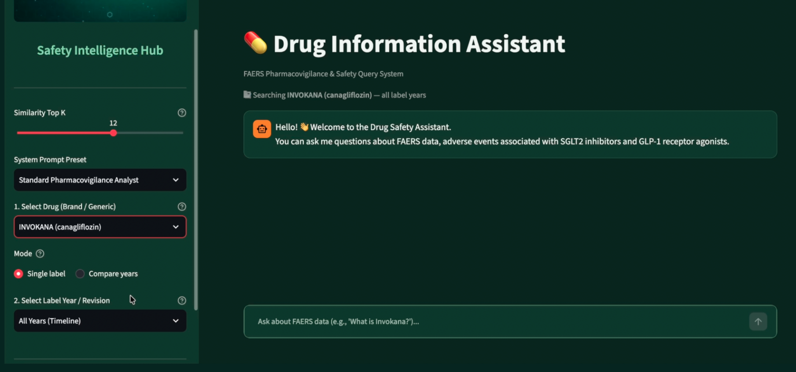

# Signal2Label: An AI-Driven Framework for FAERS Exploration, Signal Prediction, and Regulatory Verification

**Explore. Detect. Verify. Experts decide.**

Signal2Label is an AI-driven pharmacovigilance project designed to explore adverse event reports, identify potential drug safety signals, evaluate early-warning methods, and verify findings against official FDA drug labeling information.

The project uses the FDA Adverse Event Reporting System (FAERS) to investigate the safety profiles of selected antidiabetic medicines, focusing on SGLT2 inhibitors and GLP-1 receptor agonists.

It combines large-scale data processing, exploratory data analysis, disproportionality analysis, machine learning, time-based signal evaluation, and Retrieval-Augmented Generation (RAG) to support a structured drug safety investigation workflow.

**The central question: Can we identify potential medicine safety warnings early enough to support further investigation?**

---

## Project Objectives

1. Explore adverse event reporting patterns across selected antidiabetic medicines.
2. Identify potential drug–adverse event associations using disproportionality analysis.
3. Recover established safety signals as a sanity check for the analytical approach.
4. Evaluate whether statistical and machine learning methods can identify later safety warnings using information available at earlier time points.
5. Compare signal-ranking approaches using historical reporting data.
6. Verify prioritized safety signals against official FDA drug labeling documents.
7. Build an integrated workflow connecting statistical findings with regulatory information.

---

## Dataset

**Source:** [FDA Adverse Event Reporting System (FAERS)](https://fis.fda.gov/extensions/FPD-QDE-FAERS/FPD-QDE-FAERS.html)

- **Study period:** 2014–2019
- **Raw reports:** Approximately 8.31 million
- **Cleaned and deduplicated reports:** Approximately 7.44 million
- **Medicines investigated:** 7
  - 4 SGLT2 inhibitors
  - 3 GLP-1 receptor agonists
- **Final main-suspect analysis dataset:** 67,653 reports

The analysis uses FAERS spontaneous reporting data, including drug, reaction, report, and outcome information.

The seven selected medicines were investigated to compare adverse event reporting patterns across drug classes and individual ingredients.

*Note: FAERS reports represent suspected adverse events, not confirmed causal relationships.*

---

## Project Workflow

The project follows three main stages:

### 1. Explore – Exploratory Data Analysis

**Tools:** Python, DuckDB, Tableau

- Load and process large FAERS quarterly datasets.
- Link report, drug, reaction, and outcome information using case identifiers.
- Remove duplicate reports while retaining the latest case versions.
- Filter the dataset to the seven selected medicines.
- Examine adverse event distributions by medicine, age, gender, reporting year, and seriousness.
- Explore reporting trends and drug safety profiles through an interactive Tableau dashboard.

**Outcome:** A cleaned analytical dataset containing 67,653 main-suspect reports.

### 2. Detect – Disproportionality Analysis and Early-Warning Evaluation

**Tools:** Python, statistical analysis, machine learning

- Examine 9,251 drug–adverse event pairs.
- Apply disproportionality analysis to identify events reported more frequently than expected.
- Use the EB05 score to identify and prioritize potential safety signals.
- Compare established signals across SGLT2 inhibitors and GLP-1 receptor agonists.
- Evaluate traditional signal ranking, simple forecasting, and machine learning approaches.
- Use historical quarterly cutoffs to avoid using future information when evaluating early-warning performance.

**Machine learning:** Logistic regression using reporting-history features.

**Outcome:** 
- 835 potential safety signals identified.
- 613 signals classified as strong signals.
- Known safety findings, including genital infections, ketoacidosis, Fournier's gangrene, and pancreatitis, were recovered.

### 3. Verify – Historical Regulatory Verification Using RAG

**Tools:** Python, Streamlit, Retrieval-Augmented Generation (RAG), LLMs, FDA USPI documents

The regulatory verification component connects prioritized FAERS safety signals with official FDA drug labeling information.

This component was developed in two stages:

**Stage 1: Standalone RAG Drug Information Assistant**

I initially developed a standalone RAG-based Drug Safety Assistant using the latest available FDA labeling documents for the seven selected medicines.

The application was hosted online as a separate GitHub project:

**[Anti-diabetic Drug Safety RAG Assistant](https://github.com/ShymaShameer/Anti-diabetic-Drug_Safety_RAG_Assistant)**

The standalone application included three interactive features:

- **Similarity Top-K Selection:** Adjust the number of relevant document chunks retrieved for a query.
- **System Prompt Presets:** Select different system prompt configurations to guide the assistant's responses.
- **New Chat:** Start a fresh conversation.

**Stage 2: [Drug Information Assistant](https://github.com/ShymaShameer/Drug-Information-Assistant) Historical RAG Integration in Signal2Label**

For the final project, I reused the RAG architecture locally and extended it to support historical regulatory verification.

Instead of relying only on the latest drug labels, the extended system uses complete USPI (United States Prescribing Information) documents dating back to 2013.

Additional functionality includes:

- **Drug Selection:** Select a specific medicine for regulatory investigation.
- **Year Selection:** Retrieve information from the selected labeling year.
- **Year Comparison:** Compare FDA labeling information across different years to investigate when adverse events, warnings, or other safety information appeared or changed.

This extension allows the assistant to investigate whether a detected FAERS signal was already documented in the official drug label or whether the relevant safety information appeared in a later labeling update.


---

## Key Results

| Metric | Result |
|---|---:|
| Raw FAERS reports | 8.31 million |
| Cleaned and deduplicated reports | 7.44 million |
| Final main-suspect reports | 67,653 |
| Drug–event pairs examined | 9,251 |
| Potential safety signals | 835 |
| Strong safety signals | 613 |
| Later warnings captured by ML watch list | 73 out of 100 |
| Top SGLT2 signals already present in FDA labels | 23 out of 33 |

### Early-Warning Model Comparison

The early-warning evaluation compared three approaches using a top-5% watch list.

| Approach | Later warnings flagged |
|---|---:|
| Traditional score | 55 |
| Simple forecast | 68 |
| Machine learning (Logistic Regression) | 73 |

The machine learning approach identified 73 out of 100 later warnings in the evaluation.

However, the results did not demonstrate a clear improvement in warning lead time. The typical lead time was approximately 5–7 months across the evaluated methods.

An important finding was that gradual reporting patterns can be easier to identify than sudden increases in adverse event reporting. For example, Fournier's gangrene showed a sharp increase following an FDA communication in August 2018.

### Regulatory Verification

Among the top 33 prioritized SGLT2 watch-list signals:
- 23 were already present in the FDA labels.
- 5 were added in 2018.
- 2 were added in 2019.
- 1 was added in 2017.
- 2 had few reports.

The assistant provides retrieved regulatory evidence with source references and dates to support further investigation.

**The objective is to connect statistical signal detection with historical regulatory evidence, not to automate medical or regulatory decisions.**


---

## Repository Structure

```text
faers/
│
├── data/
│   ├── raw/                       # Raw FAERS data files
│   ├── faers_db.duckdb            # DuckDB database
│   └── faers_db.duckdb.wal        # Database write-ahead log
│
├── notebooks/
│   ├── 01_Loading Data.ipynb
│   ├── 02_Initial EDA.ipynb
│   ├── 03_Exploration.ipynb
│   ├── 04_Disproportionality Analysis.ipynb
│   └── 05_Forecasting.ipynb
│
├── src/
│   └── __init__.py                # Python source package
│
├── .vscode/
│
├── .gitignore
├── README.md
└── requirements.txt
```

### Notebook Guide

| Notebook | Description |
|---|---|
| `01_Loading Data.ipynb` | Loading, processing, cleaning, and preparing FAERS data. |
| `02_Initial EDA.ipynb` | Initial exploratory analysis and understanding of the dataset. |
| `03_Exploration.ipynb` | Drug safety profiles, adverse event patterns, and reporting trends. |
| `04_Disproportionality Analysis.ipynb` | Drug–event disproportionality analysis and safety signal identification. |
| `05_Forecasting.ipynb` | Historical signal evaluation, forecasting, and machine learning comparisons. |

The notebooks are organized in the order of the analytical workflow and can be used to follow the project from raw data preparation to signal evaluation.

---

## Technologies Used

| Area | Technologies |
|---|---|
| Programming | Python |
| Data processing | Pandas, DuckDB |
| Data analysis | NumPy, statistical analysis |
| Visualization | Matplotlib, Seaborn, Tableau |
| Signal detection | Disproportionality Analysis, EB05 |
| Machine learning | Scikit-learn, Logistic Regression |
| Regulatory verification | Retrieval-Augmented Generation (RAG), FDA labeling documents |
| Application framework | Streamlit |

---

## Setup and Installation

### 1. Clone the repository

```bash
git clone <your-github-repository-url>
cd faers
```

### 2. Create a virtual environment

```bash
python -m venv .venv
```

Activate the environment:

**Windows:**
```bash
.venv\Scripts\activate
```

**macOS / Linux:**
```bash
source .venv/bin/activate
```

### 3. Install dependencies

```bash
pip install -r requirements.txt
```

### 4. Prepare the FAERS data

Download the required quarterly FAERS datasets from the [FDA FAERS data source](https://fis.fda.gov/extensions/FPD-QDE-FAERS/FPD-QDE-FAERS.html).

Place the downloaded files in:

```text
data/raw/
```

The database and analysis results depend on the data preparation and cleaning steps documented in the notebooks.

### 5. Run the notebooks

Start Jupyter Notebook:

```bash
jupyter notebook
```

Execute the notebooks in numerical order, beginning with data loading and ending with forecasting.

*Note: Raw FAERS files are not included in the repository. The database and any generated artifacts may need to be recreated locally, depending on which files are committed.*

---

## Dashboard and Project Presentation

**Interactive Tableau Dashboard:**

[Explore the FAERS Anti-Diabetic Drug Safety Dashboard](https://public.tableau.com/app/profile/shyma.shameer/viz/FAERSproject/Dashboard1?publish=yes)

The dashboard provides an interactive overview of adverse event reporting patterns, including:

- Drug and ingredient-level comparisons.
- Demographic distributions.
- Serious and non-serious outcomes.
- Frequently reported adverse events.
- Annual reporting trajectories.

The project presentation also demonstrates the integrated Signal2Label workflow, including the Streamlit-based regulatory verification assistant.

---

## Limitations and Responsible Use

FAERS is a spontaneous reporting system and has several important limitations:

- Reports do not establish that a medicine caused an adverse event.
- Under-reporting and stimulated reporting may influence observed patterns.
- Duplicate and incomplete reports can affect analytical results.
- Reporting counts do not provide information about the actual incidence of adverse events.
- Disproportionality measures identify statistical associations, not causal relationships.
- Early-warning performance depends on the historical reporting patterns and evaluation design.
- Regulatory label verification depends on the availability, completeness, and dates of the retrieved documents.

**Signal2Label is an exploratory pharmacovigilance and decision-support framework, not a clinical decision-making or automated regulatory approval system.**

All safety decisions require expert assessment and appropriate regulatory review.

---

## Future Improvements

- Expand the analysis to additional therapeutic areas and drug classes.
- Evaluate more forecasting and machine learning approaches.
- Improve early-warning lead-time evaluation.
- Extend the regulatory document collection and historical label comparisons.
- Improve the integration between statistical signal detection and the RAG assistant.

---

## References

1. [FDA Adverse Event Reporting System (FAERS)](https://fis.fda.gov/extensions/FPD-QDE-FAERS/FPD-QDE-FAERS.html)
2. [FDA Drugs@FDA – Drug Approval and Labeling Information](https://www.accessdata.fda.gov/scripts/cder/daf/index.cfm)
3. DuMouchel, W. (1999). Bayesian data mining in large frequency tables, with an application to the FDA spontaneous reporting system. *The American Statistician*, 53(3), 177–190.
4. Szarfman, A., Machado, S. G., & O'Neill, R. T. (2002). Use of screening algorithms and computer systems to efficiently signal higher-than-expected combinations of drugs and events in the US FDA's spontaneous reports database. *Drug Safety*, 25(6), 381–392.

---

## Author

**Shyma Shameer**

Data Science & AI Course Project | November 2026

---

*For educational and research purposes only. Not intended for clinical decision-making or as a substitute for professional medical or regulatory assessment.*
